# Aethelgard: Sendas y Criaturas

Aplicación web tipo RPG táctico por turnos de exploración, captura, gestión de equipo y combate elemental.  
**Proyecto Integrador — ISC-305 Programación Web (III PAC 2026).**

> **Estado actual del proyecto:** **Fases 0 a 10 completadas en la rama `desarrollo`.**  
> La aplicación cuenta con Front-End en React 19 + TypeScript + Vite + Tailwind CSS v4 + `8bitcn/ui` conectado a un Back-End en NestJS 10 + Prisma 6 + PostgreSQL + JWT, con 30 especies canónicas (basadas en Open5e SRD 5.2), 4 zonas desbloqueables, motor de combate táctico con 52 efectos mecánicos únicos, afinidades elementales, captura con talismanes, tienda, inventario, santuario de curación y estética retro 8-bit/16-bit.

---

## Tabla de Contenidos

1. [¿De qué trata el proyecto y cómo está construido?](#1-de-qué-trata-el-proyecto-y-cómo-está-construido)
2. [Requisitos previos](#2-requisitos-previos)
3. [Instalación y arranque paso a paso (Con Docker o con PostgreSQL local)](#3-instalación-y-arranque-paso-a-paso-con-docker-o-con-postgresql-local)
4. [Estructura del monorepo](#4-estructura-del-monorepo)
5. [Reglas de oro para contribuir (Lectura obligatoria para el equipo)](#5-reglas-de-oro-para-contribuir-lectura-obligatoria-para-el-equipo)
6. [Flujo de Git y Pull Requests (Todo va hacia `desarrollo`, NUNCA a `main`)](#6-flujo-de-git-y-pull-requests-todo-va-hacia-desarrollo-nunca-a-main)
7. [Cómo trabajar con Agentes de IA sin cometer errores](#7-cómo-trabajar-con-agentes-de-ia-sin-cometer-errores)
8. [Documentación en `/docs` y qué debes actualizar en cada cambio](#8-documentación-en-docs-y-qué-debes-actualizar-en-cada-cambio)
9. [Estado de avance, partes que aún faltan y flujo final de entrega](#9-estado-de-avance-partes-que-aún-faltan-y-flujo-final-de-entrega)
10. [Comandos útiles de desarrollo y verificación](#10-comandos-útiles-de-desarrollo-y-verificación)
11. [Créditos y licencias](#11-créditos-y-licencias)

---

## 1. ¿De qué trata el proyecto y cómo está construido?

**Aethelgard: Sendas y Criaturas** es un juego RPG web donde el jugador crea una cuenta con su personaje explorador, elige su criatura inicial y recorre las regiones de Aethelgard descubriendo criaturas salvajes, combatiendo por turnos con ventajas elementales y estados alterados, capturando nuevas especies mediante talismanes, organizando su equipo activo (máximo 6 criaturas) y almacén de reserva, comprando consumibles en el bazar y restaurando a su escuadrón en el santuario.

### Principios arquitectónicos clave

1. **Soberanía total del servidor (`apps/api`):** Toda regla del juego (fórmulas de daño, probabilidades de captura, experiencia, subida de nivel, economía de monedas, desbloqueo de zonas y validación de turnos) se calcula y valida **exclusivamente en el Back-End**. El Front-End jamás decide resultados ni envía modificadores de daño o probabilidades; únicamente representa el estado devuelto por el servidor.
2. **Identidad segura por JWT (`S-1`):** El `personajeId` y `usuarioId` se extraen siempre del token JWT verificado en el servidor (`AutenticacionGuard` + `@UsuarioActual()`), nunca desde el cuerpo (`body`) ni parámetros de la URL.
3. **Aislamiento de la API externa (`Anexo A.4`):** El catálogo de 30 criaturas parte de datos de **Open5e (SRD 5.2)** normalizados e importados a la base de datos local (`prisma/seed.ts` y `bestiario-canonico.ts`). Durante el juego en vivo no se depende de llamadas externas para evitar latencia o caídas de terceros.
4. **Aleatoriedad determinista para pruebas:** Todo cálculo probabilístico utiliza la interfaz `GeneradorAleatorio` inyectable, lo que permite probar casos borde con generadores fijos en las suites unitarias y e2e.
5. **Estética Retro Aethelgard (`8bitcn/ui`):** Interfaz inspirada en clásicos de 8-bit/16-bit con paleta oscura de alto contraste (`docs/DESIGN.md`), tipografía bimodal (`Press Start 2P` para encabezados/controles y `Geist` para lectura fluida), efectos de sonido sintetizados mediante Web Audio API y **cero emojis Unicode** en controles (se usan iconos vectoriales de `lucide-react`).

---

## 2. Requisitos previos

Asegúrate de tener instaladas las siguientes herramientas antes de clonar el proyecto:

- **Node.js:** `v24.0.0` o superior (`node -v`)
- **pnpm:** `v10.28.1` (`corepack enable && corepack prepare pnpm@10.28.1 --activate` o `npm i -g pnpm@10.28.1`)
- **Base de datos PostgreSQL (elige UNA de las dos opciones):**
  - **Opción A (Sin Docker):** Tener **PostgreSQL** (v15, v16 o v17) instalado localmente en tu computadora.
  - **Opción B (Con Docker):** Tener **Docker Desktop** instalado y en ejecución.
- **Git:** Configurado con tu nombre y correo (`git config --global user.name` y `git config --global user.email`)

---

## 3. Instalación y arranque paso a paso (Con Docker o con PostgreSQL local)

> [!IMPORTANT]
> **¡Atención al clonar!** La rama activa de trabajo del equipo es **`desarrollo`**. La rama `main` solo recibe cierres de avance calificados, por lo que al clonar debes cambiarte inmediatamente a `desarrollo`.

### Paso 1: Clonar y ubicarse en la rama `desarrollo`

```bash
git clone https://github.com/EduardoVal3/aventura-web-criaturas.git
cd aventura-web-criaturas
git switch desarrollo
git pull origin desarrollo
```

### Paso 2: Configurar las variables de entorno (`.env`)

Los archivos `.env` contienen credenciales locales y **nunca se suben a GitHub**. Debes crear tres archivos `.env` copiando las plantillas incluidas en el repositorio:

**En Windows (PowerShell):**
```powershell
Copy-Item .env.example .env
Copy-Item .env.example apps/api/.env
Copy-Item apps/web/.env.example apps/web/.env
```

**En Linux / macOS / Git Bash:**
```bash
cp .env.example .env
cp .env.example apps/api/.env
cp apps/web/.env.example apps/web/.env
```

- **Si usas PostgreSQL instalado localmente (sin Docker):** Abre `.env` y `apps/api/.env` y reemplaza `cambiar_esta_contrasena` por la contraseña real de tu usuario `postgres` local (tanto en `POSTGRES_PASSWORD` como dentro de la cadena `DATABASE_URL`).
- **Si usas Docker:** Puedes dejar la contraseña que viene en la plantilla o ajustarla (siempre que coincida en `.env` y `apps/api/.env`).

### Paso 3: Instalar dependencias y activar los hooks de protección de Git

```bash
pnpm install
```
> Al ejecutar `pnpm install`, el script `prepare` configura automáticamente `.githooks/` como ruta de hooks de Git. Estos hooks **bloquean cualquier intento de hacer commit directo en `main`** y **validan que todos los mensajes de commit cumplan el formato en español**.

### Paso 4: Preparar la base de datos, migraciones y catálogo (Seed)

Elige **una** de las dos alternativas según tu entorno:

#### Alternativa A: Usando PostgreSQL instalado en local (sin Docker)
1. Asegúrate de que el servicio de PostgreSQL esté corriendo en tu máquina y crea la base de datos `aventura_criaturas` (desde pgAdmin o en terminal con `psql -U postgres -c "CREATE DATABASE aventura_criaturas;"`).
2. Ejecuta las migraciones y el seed:
   ```bash
   pnpm --filter api exec prisma migrate deploy
   pnpm --filter api exec prisma generate
   pnpm --filter api exec prisma db seed
   ```

#### Alternativa B: Usando Docker Desktop
1. Levanta el contenedor de PostgreSQL y aplica las migraciones y el seed:
   ```bash
   docker compose up -d postgres
   pnpm --filter api exec prisma migrate deploy
   pnpm --filter api exec prisma generate
   pnpm --filter api exec prisma db seed
   ```

### Paso 5: Iniciar el entorno de desarrollo

Desde la raíz del monorepo puedes arrancar tanto el Back-End como el Front-End en paralelo:

```bash
# Intenta levantar el contenedor de Docker si tienes Docker activo; si no tienes Docker, usa tu PostgreSQL local automáticamente:
pnpm dev

# O si prefieres saltar por completo la verificación de Docker y usar directo tu PostgreSQL local:
pnpm dev:local
```

- **Aplicación Web (Front-End):** [http://localhost:5173](http://localhost:5173)
- **Servidor API (Back-End — Salud):** [http://localhost:3000/api/salud](http://localhost:3000/api/salud)

---

## 4. Estructura del monorepo

```text
aventura-web-criaturas/
├── .github/
│   └── pull_request_template.md   # Plantilla obligatoria al abrir cada Pull Request
├── .githooks/
│   ├── pre-commit                 # Bloquea commits directos en main/master
│   └── commit-msg                 # Exige formato: tipo(alcance): descripción en español
├── apps/
│   ├── api/                       # Back-End en NestJS 10 + Prisma 6 + PostgreSQL
│   │   ├── prisma/                # schema.prisma, migraciones y seed.ts
│   │   ├── src/
│   │   │   ├── comun/             # Guards JWT, filtros de excepción, decoradores, Prisma, azar
│   │   │   └── modulos/           # Módulos de dominio (autenticacion, personajes, mundo,
│   │   │                          # exploracion, encuentros, combate, criaturas, equipo,
│   │   │                          # inventario, tienda, curacion, progreso, historial, externo)
│   │   └── test/                  # Pruebas unitarias (*.spec.ts) y extremo a extremo (*.e2e-spec.ts)
│   └── web/                       # Front-End en React 19 + TypeScript + Vite + Tailwind v4
│       ├── public/assets/         # Recursos gráficos (zonas, criaturas, objetos) y README de assets
│       ├── src/
│       │   ├── api/               # Cliente HTTP (apiHttp.ts), interfaz (ApiJuego.ts) y tipos DTO
│       │   ├── components/        # LayoutPrincipal, RutaProtegida, arena de combate y 8bitcn/ui
│       │   ├── contextos/         # ContextoAutenticacion (sesión JWT y estado del jugador)
│       │   ├── lib/               # Utilidades de dominio UI, audio Web Audio API y validadores
│       │   └── paginas/           # Pantallas del juego (Ingreso, Registro, CrearPersonaje,
│       │                          # HubUbicacion, Exploracion, Combate, Equipo, Almacen,
│       │                          # Inventario, Tienda, Curacion, Historial, Catalogo)
│       └── test/                  # Pruebas unitarias de interfaz y lógica cliente (*.spec.ts)
├── datos/
│   └── open5e-srd-2024-seleccion.json # Snapshot base de criaturas SRD 5.2
├── docs/                          # Documentación técnica, reglas, diseño e informe incremental
├── docker-compose.yml             # Definición opcional de contenedor PostgreSQL / Gateway
└── package.json                   # Scripts globales del workspace pnpm
```

---

## 5. Reglas de oro para contribuir (Lectura obligatoria para el equipo)

Antes de escribir una sola línea de código, todo integrante debe conocer las 3 reglas transversales detalladas en [`docs/reglas-de-trabajo.md`](docs/reglas-de-trabajo.md):

### R1. Código, rutas, modelos, commits y textos 100% en español

- **Todo lo que nombramos nosotros va en español:** variables, funciones, clases, interfaces, DTOs, modelos y columnas de Prisma, rutas REST (`/api/exploracion`, `/api/combate/atacar`), nombres de archivos (`captura.service.ts`, `PantallaCombate.tsx`), ramas de Git, mensajes de commit, comentarios y textos visibles en pantalla.
- **Convenciones de escritura:**
  - Los identificadores de código **no llevan tildes ni `ñ`** (`exploracion`, `contrasena`, `danio`); los comentarios y los textos de la interfaz de usuario **sí llevan ortografía completa** con tildes y `ñ`.
  - Variables y funciones en `camelCase`, clases/componentes/modelos en `PascalCase`, constantes en `MAYUSCULAS_CON_GUION_BAJO`, archivos de Back-End en `kebab-case` (`motor-combate.ts`) y componentes de React en `PascalCase` (`PanelTactico.tsx`).
  - Hooks propios de React llevan el prefijo `use` seguido del nombre en español (`useAutenticacion`), porque React impone `use`.
- **Cero emojis Unicode en la interfaz:** No uses emojis (`⚔️`, `🧪`, `❤️`, etc.) en botones, etiquetas ni paneles del juego. Usa exclusivamente iconos SVG de `lucide-react`.
- **Únicas palabras en inglés permitidas (Glosario Técnico):**
  - Palabras reservadas del lenguaje/librerías (`const`, `async`, `useState`, `findMany`, `@Controller`, `CanActivate`).
  - Componentes generados por `8bitcn/ui` y `shadcn/ui` (`Button`, `Card`, `HealthBar`, `Badge`, `Dialog`).
  - Siglas universales (`HP`, `XP`, `JWT`, `API`, `DTO`, `HTTP`, `JSON`, `SQL`, `ID`, `CORS`, `CRUD`, `REST`, `URL`).
  - Sufijos arquitectónicos del glosario: `Guard`, `Controller`, `Service`, `Module`, `Pipe`, `Filter`, `Interceptor`, `Middleware`, `Gateway`, `Layout`, `seed`, `token`, `payload`.

### R2. Prohibido subir archivos de configuración de agentes o herramientas

- **En GitHub solo debe vivir el código fuente, las pruebas y la documentación oficial del proyecto.**
- El archivo `.gitignore` ya está configurado para ignorar directorios y archivos de agentes de IA, servidores MCP e IDEs (`.agents/`, `.agent/`, `.gemini/`, `.claude/`, `.cursor/`, `.windsurf/`, `.cline/`, `.roo/`, `.vscode/`, `.idea/`, `CLAUDE.md`, `AGENTS.md`, `GEMINI.md`, `.cursorrules`, `.mcp.json`, `mcp_config.json`, `graphify-out/`, `docs/workflows/`, etc.).
- **Nunca uses `git add -f`** para forzar la subida de configuraciones personales de tu editor o agente de IA, ni subas jamás archivos `.env`.

### R3. Calidad y cero regresiones antes de subir cambios

Ninguna rama puede abrir Pull Request si rompe la compilación o las pruebas existentes. Antes de hacer `git push`, ejecuta siempre:

```bash
pnpm --filter api test
pnpm --filter web test
pnpm --filter web build
pnpm --filter web lint
```

---

## 6. Flujo de Git y Pull Requests (Todo va hacia `desarrollo`, NUNCA a `main`)

El historial de Git es evaluado directamente por el profesor para verificar la evolución progresiva y el aporte individual de cada miembro del equipo.

```mermaid
flowchart LR
    D1["desarrollo (Rama base del equipo)"] --> R["Crear rama:<br/>tipo/fase-XX-descripcion"]
    R --> C["Commits atómicos en español:<br/>tipo(alcance): descripción"]
    C --> V["Validar:<br/>tests + build + actualizar /docs"]
    V --> PR["Abrir Pull Request<br/>base: desarrollo ← compare: tu-rama"]
    PR --> MC["Integrar con Merge Commit<br/>(NUNCA Squash ni Rebase)"]
    MC --> D2["desarrollo actualizado"]
    D2 -. "Solo al cerrar el proyecto final" .-> M["main (tag: version-1.0.0)"]
```



### Reglas estrictas de ramas, commits y PRs

1. **PROHIBIDO hacer commits o Pull Requests directos a `main`:**
   - `main` es únicamente la rama de entregas cerradas.
   - **Todo el trabajo diario sale de `desarrollo` y vuelve a `desarrollo` mediante Pull Request.**
2. **Nomenclatura de ramas:**
   Crea una rama nueva desde `desarrollo` por cada tarea, pantalla, extra o corrección usando uno de los prefijos permitidos:
   - `funcionalidad/<nombre>` (ej. `funcionalidad/fase-11b-auditoria-ui`)
   - `configuracion/<nombre>` (ej. `configuracion/fase-11a-api-gateway`)
   - `correccion/<nombre>` (ej. `correccion/ajuste-responsive-tienda`)
   - `documentacion/<nombre>` (ej. `documentacion/fase-12-entrega-final`)
   - `pruebas/<nombre>` (ej. `pruebas/cobertura-endpoints-progreso`)
3. **Formato obligatorio de commits (validado por `.githooks/commit-msg`):**
   ```text
   tipo(alcance): descripción clara en español de al menos 10 caracteres
   ```
   - **Tipos válidos:** `funcionalidad`, `correccion`, `documentacion`, `configuracion`, `pruebas`, `refactorizacion`, `diseno`.
   - **Ejemplos correctos:**
     - `configuracion(gateway): agrega Kong DB-less al docker-compose`
     - `funcionalidad(ux-combate): agrega indicador visual de turno activo`
     - `documentacion(informe): documenta evidencia de rate-limiting en 10-extras`
   - Haz **commits pequeños y atómicos** (un commit por cada subtarea lógica; no acumules 30 archivos distintos en un solo commit gigante).
   - **Historial honesto:** Prohibido alterar fechas (`--date`, `GIT_AUTHOR_DATE`), prohibido usar `git push --force` y prohibido reescribir la historia.
4. **Cómo abrir e integrar tu Pull Request en GitHub:**
   ```bash
   # 1. Asegúrate de partir de desarrollo actualizado
   git switch desarrollo
   git pull origin desarrollo

   # 2. Crea tu rama de trabajo
   git switch -c <tipo>/<nombre-de-tu-tarea>

   # 3. Realiza tus cambios, corre las pruebas, actualiza /docs y haz commits atómicos
   git add <archivos-modificados>
   git commit -m "tipo(alcance): descripción en español"

   # 4. Sube tu rama al repositorio remoto
   git push -u origin <tipo>/<nombre-de-tu-tarea>
   ```
   - Entra a GitHub y crea el Pull Request asegurándote de seleccionar:
     - **base:** `desarrollo` *(¡Verifica que NO diga `main`!)*
     - **compare:** `<tipo>/<nombre-de-tu-tarea>`
   - Completa todas las secciones y casillas de verificación de la plantilla automática (`.github/pull_request_template.md`).
   - Al integrar el PR, usa **exclusivamente la opción "Create a merge commit"** (`--no-ff`). **Nunca uses "Squash and merge" ni "Rebase and merge"**, porque el squash borra los commits individuales de la historia.

---

## 7. Cómo trabajar con Agentes de IA sin cometer errores

Si utilizas asistentes o agentes de programación con IA (Cursor, Antigravity/Gemini, Claude Code, Windsurf, GitHub Copilot, Cline, Roo Code, etc.), sigue este protocolo para que el agente respete la arquitectura del proyecto y no introduzca errores:

### 7.1 Configuración local de tu agente
- Cualquier archivo de instrucciones de tu agente (`CLAUDE.md`, `AGENTS.md`, `.cursorrules`, `.agents/`, `.cursor/`, `.claude/`, `.mcp.json`, etc.) **es local a tu máquina** y ya está ignorado en `.gitignore`.
- Si deseas configurar servidores **MCP (Model Context Protocol)** en tu IDE (PostgreSQL, Docker, Fetch, Mermaid, Context7, GitHub, Graphify), revisa la guía y plantilla sin credenciales en [`docs/mcp.md`](docs/mcp.md).

### 7.2 Qué contexto darle al agente al iniciar una sesión (Ahorro de tokens)
No le pidas al agente que lea todo el repositorio a ciegas. En tu primer mensaje (o en tus reglas locales del agente), indícale que lea primero estos documentos ligeros:
1. **[`docs/INDICE.md`](docs/INDICE.md):** Es el enrutador maestro (~2 KB) que explica en qué fase estamos y qué documento consultar según el dominio.
2. **[`docs/reglas-de-trabajo.md`](docs/reglas-de-trabajo.md):** Contiene la regla R1 (español estricto y glosario), R2 (commits y ramas) y las 7 reglas transversales de diseño.
3. **Solo el documento del dominio que vayas a tocar:**
   - Si vas a tocar Front-End / UI → [`docs/DESIGN.md`](docs/DESIGN.md)
   - Si vas a tocar endpoints / DTOs → [`docs/contrato-api.md`](docs/contrato-api.md)
   - Si vas a tocar fórmulas / balance / combate → [`docs/reglas-juego.md`](docs/reglas-juego.md) y [`docs/catalogo-criaturas.md`](docs/catalogo-criaturas.md)

### 7.3 Flujo de trabajo en dos tiempos con el agente
1. **Tiempo 1 — Diagnóstico y Planificación:** Pídele al agente que analice los archivos involucrados, verifique que no se rompa ninguna regla del servidor y divida el trabajo en subtareas pequeñas con sus mensajes de commit en español.
2. **Tiempo 2 — Ejecución Quirúrgica y Verificación:**
   - Pídele que implemente una subtarea a la vez.
   - Exígele que verifique que no haya emojis Unicode en la UI, que use los componentes de `src/components/ui/8bit/`, que prevenga el doble clic en botones asíncronos (`disabled` / `aria-busy`) y que mantenga el diseño responsive sin desbordamiento horizontal (`overflow-x`).
   - Pídele que ejecute `pnpm --filter api test`, `pnpm --filter web test` y `pnpm --filter web build` antes de cada commit.
3. **Tiempo 3 — Sincronización Documental Obligatoria:** Pídele al agente que actualice los archivos correspondientes dentro de `/docs` (ver sección 8) antes de dar por terminada la tarea.

---

## 8. Documentación en `/docs` y qué debes actualizar en cada cambio

> [!WARNING]
> **Regla crítica del equipo:** Ningún cambio en el código está completo si no se actualiza su documentación en `/docs`. El informe técnico final para el ingeniero Claudio se construye directamente a partir de `/docs/informe/` y los documentos satélite.

### Mapa completo de `/docs` y cuándo actualizar cada archivo

| Archivo o Carpeta | Qué contiene | ¿Cuándo estás OBLIGADO a actualizarlo? |
| :--- | :--- | :--- |
| [`docs/INDICE.md`](docs/INDICE.md) | Mapa general de fases (0 a 13), estado de cada una y tabla de documentos satélite. | Cuando se inicia o se completa una fase o subfase (cambiar estado a `✅ Completada`). |
| [`docs/reglas-de-trabajo.md`](docs/reglas-de-trabajo.md) | Reglas R1 (español y glosario), R2 (Git y hooks), R3 (MCP) y reglas transversales. | Si el equipo acuerda agregar un término técnico nuevo al glosario permitido. |
| [`docs/contrato-api.md`](docs/contrato-api.md) | Especificación completa de todos los endpoints REST (`/api/...`), parámetros, DTOs, respuestas JSON y códigos de error. | **Siempre** que agregues un endpoint nuevo o modifiques la ruta, cuerpo de petición o respuesta JSON de un endpoint existente. |
| [`docs/reglas-juego.md`](docs/reglas-juego.md) | Todas las fórmulas matemáticas del servidor: normalización, daño elemental, probabilidad de captura, curva de XP, efectos de estado y economía. | **Siempre** que ajustes una fórmula matemática, probabilidad, efecto de combate, precio o invariante numérico (junto con su prueba unitaria). |
| [`docs/catalogo-criaturas.md`](docs/catalogo-criaturas.md) | Bestiario canónico de las 30 criaturas, jerarquías (`J-1` a `J-4`), estadísticas base, sets de movimientos y tablas de aparición por zona. | Si modificas estadísticas base, movimientos asignados o pesos de aparición en `bestiario-canonico.ts` o `seed.ts`. |
| [`docs/DESIGN.md`](docs/DESIGN.md) | Sistema de diseño retro Aethelgard: paleta HSL, tipografía bimodal, bordes pixelados, componentes `8bitcn/ui` y reglas de accesibilidad. | Si creas nuevos tokens de color, estilos globales en `index.css` o patrones visuales reutilizables. |
| [`docs/decisiones.md`](docs/decisiones.md) | Bitácora de decisiones arquitectónicas y técnicas (`D-01`, `D-02`...) con justificación, URL oficial y versión verificada. | **Siempre** que incorpores una tecnología o librería nueva (p. ej. Kong en la Fase 11), cambies una regla de alcance o tomes una decisión de arquitectura. |
| [`docs/diseno-juego.md`](docs/diseno-juego.md) y [`docs/wireframes.md`](docs/wireframes.md) | Concepto narrativo del mundo de Aethelgard, bucle principal del jugador y bocetos estructurales de las pantallas. | Si se agrega una pantalla nueva o cambia el flujo de navegación entre vistas. |
| [`docs/mcp.md`](docs/mcp.md) | Documentación y plantilla (sin credenciales) de los servidores MCP de apoyo. | Si se añade un nuevo servidor MCP al flujo de desarrollo. |
| [`docs/diagramas/*.mmd`](docs/diagramas/) | Código fuente en formato Mermaid de los diagramas de arquitectura, modelo conceptual, entidad-relación, estados y secuencias. | **Siempre** que cambie el esquema de Prisma (`modelo-datos.mmd`), la arquitectura de contenedores (ej. `arquitectura-con-gateway.mmd` en Fase 11) o un flujo de secuencia. |
| [`docs/informe/`](docs/informe/) | Secciones incrementales del Informe Técnico académico (`01-concepto-y-diseno.md` hasta `09-experiencia-usuario.md`, y próximas `10-extras.md` y `11-pruebas-y-demo.md`). | **En cada tarea, mejora de UI o fase.** Todo aporte debe quedar redactado técnicamente en la sección correspondiente de `docs/informe/` detallando qué problema resuelve, cómo se implementó y qué pruebas lo respaldan. |

### Estructura actual de `docs/informe/`

1. `01-concepto-y-diseno.md` — Concepto del juego, mundo, módulos y bucle jugable (Fase 1).
2. `02-frontend-y-sistema-de-diseno.md` — Arquitectura Front-End, React, Tailwind y `8bitcn/ui` (Fase 2).
3. `03-prototipo-frontend.md` — Navegación de pantallas y estados del cliente (Fase 3).
4. `04-backend-y-api-rest.md` — Arquitectura NestJS, controladores, guards JWT e integración Front↔API (Fases 4 y 8).
5. `05-modelo-de-datos.md` — Esquema relacional en PostgreSQL, Prisma y migraciones (Fase 5).
6. `06-reglas-de-juego.md` — Motor de exploración, combate por turnos, captura, progresión y economía (Fases 6 y 7).
7. `07-integracion-externa.md` — Adaptador y normalización del catálogo desde Open5e SRD 5.2 (Fase 5b).
8. `08-seguridad.md` — Cumplimiento y pruebas e2e de los requisitos de seguridad `S-1` a `S-7` (Fase 9).
9. `09-experiencia-usuario.md` — Auditoría y rediseño UX retro pantalla por pantalla, bestiario canónico y motor táctico de 52 efectos (Fase 10, subfases 10a a 10l).

---

## 9. Estado de avance, partes que aún faltan y flujo final de entrega

### 9.1 Lo que YA está terminado (Fases 0 a 10)

| Fase | Alcance completado | Estado |
| :---: | :--- | :---: |
| **Fases 0 a 3** | Cimientos del monorepo, diseño conceptual, sistema de diseño `8bitcn/ui` y todas las pantallas del cliente. | ✅ Completada |
| **Fases 4 a 7** | Back-End en NestJS + JWT, modelo de datos en PostgreSQL/Prisma, importación Open5e, exploración ponderada, combate por turnos, captura, equipo/almacén, tienda, inventario, curación e historial. | ✅ Completada |
| **Fases 8 y 9** | Integración completa Front-End ↔ API REST y suite de seguridad `S-1` a `S-7` en verde. | ✅ Completada |
| **Fase 10 (10a–10l)** | Pulido UX retro integral pantalla por pantalla, audio Web Audio API, bestiario canónico de 30 criaturas, jerarquías `J-1` a `J-4` y combate táctico elemental con 52 efectos mecánicos únicos y vista responsive. | ✅ Completada |

---

### 9.2 Las partes que AÚN FALTAN por realizar (Trabajo en equipo)

Aquí es donde entra el trabajo coordinado del grupo para cerrar el proyecto al 100% con dirección de arte, los puntos extra y la defensa final:

#### Pendiente 1 — Dirección de Arte, Prompt Maestro y Generación de Assets Visuales (`apps/web/public/assets/`)

Actualmente el juego utiliza *placeholders* SVG automáticos (`placeholder-criatura.svg`, `placeholder-zona.svg`, `placeholder-objeto.svg`) mientras se generan los artes definitivos. El sistema en [`apps/web/src/lib/assets.ts`](apps/web/src/lib/assets.ts) ya está programado para cargar automáticamente las imágenes `.webp` apenas se coloquen en sus carpetas (ver especificaciones en [`apps/web/public/assets/README.md`](apps/web/public/assets/README.md)).

- **Qué falta definir y producir en equipo:**
  1. **Diseñar el Prompt Maestro de Dirección de Arte:** Definir una estructura de prompt base que mantenga coherencia absoluta con la historia oscura/arcana de *Aethelgard* ([`docs/diseno-juego.md`](docs/diseno-juego.md)) y la paleta retro 8-bit/16-bit ([`docs/DESIGN.md`](docs/DESIGN.md)).
  2. **Sprites e ilustraciones de las 30 Criaturas (`apps/web/public/assets/criaturas/<slug>.webp`, 512×512 px):** Cada una de las 30 especies de [`docs/catalogo-criaturas.md`](docs/catalogo-criaturas.md) debe verse increíble, imponente, intimidante y sumamente llamativa, de modo que su sola apariencia en el catálogo o en un encuentro salvaje motive al jugador a querer capturarla. El diseño debe reflejar su elemento (`FUEGO`, `AGUA`, `NATURA`, `SOMBRA`, `LUZ`) y su escala de poder desde `J-1 (Común)` hasta `J-4 (Legendaria)`.
  3. **Paisajes de las 4 Zonas (`apps/web/public/assets/zonas/<slug>.webp`, 800×450 px, 16:9) y Fondos de Combate (`battlegrounds/`):** Ilustraciones panorámicas retro para cada región de Aethelgard con la misma línea visual.
  4. **Iconos de Objetos del Bazar (`apps/web/public/assets/objetos/<slug>.webp`, 256×256 px):** Artes retro para los talismanes de captura y las pociones de curación.

#### Pendiente 2 — Fase 11: Extras de Puntos (+5 puntos sobre la nota)

Se divide en dos sub-ramas independientes que se abren desde `desarrollo` y hacen PR hacia `desarrollo`:

1. **Subfase 11a — API Gateway con Kong DB-less (+2 puntos, requisito `X-API`):**
   - **Rama:** `configuracion/fase-11a-api-gateway`
   - **Qué hay que hacer:**
     - Agregar el servicio **Kong en modo DB-less** (sin base de datos adicional, usando configuración declarativa versionada `kong.yml`) dentro de `docker-compose.yml`, ubicándolo delante de `apps/api`.
     - Configurar los plugins `key-auth` y `rate-limiting` sobre las rutas de exploración (`/api/exploracion`) y habilitar el registro de logs/métricas.
     - Apuntar el Front-End al puerto del Gateway mediante la variable `VITE_URL_API`.
     - Generar la evidencia: realizar peticiones repetidas a `/api/exploracion` a través del Gateway hasta recibir el código HTTP `429 Too Many Requests` y capturar las cabeceras de límite de tasa (`X-RateLimit-*`) y los logs del contenedor de Kong.
     - Crear el diagrama `docs/diagramas/arquitectura-con-gateway.mmd`.
     - Registrar la versión y documentación oficial de Kong en `docs/decisiones.md` y redactar el apartado en **`docs/informe/10-extras.md`**.

2. **Subfase 11b — Auditoría Integral de UI Especializada `8bitcn/ui` (+3 puntos, requisito `X-UI`):**
   - **Rama:** `funcionalidad/fase-11b-auditoria-ui`
   - **Qué hay que hacer:**
     - Realizar y documentar la auditoría funcional y visual de todos los componentes de `8bitcn/ui` integrados en la aplicación (`HealthBar`, `EnemyHealthDisplay`, `XpBar`, `Card`, `Badge`, `Dialog`, `AlertDialog`, `Tabs`, `Table`, `Button`, `Select`, `Toast`, etc.).
     - Verificar consistencia cromática, contraste, comportamiento responsive en móvil y escritorio y ausencia de regresiones.
     - Elaborar la matriz de verificación de componentes y capturas de evidencia para la demostración en **`docs/informe/10-extras.md`**.

#### Pendiente 3 — Fase 12: Entrega Final, Informe Consolidado y Defensa (`FIN`)

- **Rama:** `documentacion/fase-12-entrega-final`
- **Qué hay que hacer:**
  1. **Consolidación del Informe Técnico:** Unificar todas las secciones de `docs/informe/` (`01` a `11`) en el documento académico final revisando coherencia entre arquitectura, modelo ER, contrato REST, fórmulas matemáticas, seguridad, experiencia de usuario y extras.
  2. **Exportación de Diagramas Mermaid:** Exportar todos los archivos `.mmd` de `docs/diagramas/` a imágenes `.png` de alta resolución para incluirlos en el documento de entrega:
     ```bash
     npx -p @mermaid-js/mermaid-cli mmdc -i docs/diagramas/modelo-datos.mmd -o docs/diagramas/modelo-datos.png
     ```
  3. **Exportación de Especificación Swagger / OpenAPI:** Generar y versionar el archivo de especificación OpenAPI de los endpoints de NestJS.
  4. **Guion de Demostración (~10 minutos) en `docs/informe/11-pruebas-y-demo.md`:** Documentar el recorrido paso a paso en vivo con datos seed (registro/ingreso, creación de personaje, hub, exploración, combate táctico elemental, captura, gestión de equipo/almacén, compra en bazar, curación en santuario, catálogo/historial y demostración del rate-limiting 429 en el API Gateway).
  5. **Distribución de Módulos y Ensayo de Defensa para los 8 Integrantes:**
     Cada integrante del grupo debe conocer el flujo completo del proyecto y ser responsable de defender con solvencia su módulo asignado (explicando tanto la vista en React como el controlador/servicio en NestJS, el modelo en Prisma y las pruebas):
     - **Integrante 1:** Arquitectura general, monorepo, Docker, base de datos Prisma/PostgreSQL y seguridad JWT (`M-USR`, `S-1`..`S-7`).
     - **Integrante 2:** Creación de personaje, mundo de Aethelgard, viaje entre zonas y requisitos de progreso (`M-PJ`, `M-MUN`, `M-PRO`).
     - **Integrante 3:** Integración y normalización de Open5e SRD 5.2 y Bestiario Canónico de 30 criaturas (`M-CRI`, `Anexo A`).
     - **Integrante 4:** Motor de exploración, selector ponderado con generador inyectable y creación de encuentros (`M-EXP`, `M-ENC`).
     - **Integrante 5:** Motor de combate por turnos, fórmulas de daño elemental y los 52 efectos tácticos (`M-COM`).
     - **Integrante 6:** Mecánica y fórmula matemática de captura con talismanes y gestión de Equipo Activo (máx. 6) y Almacén (`M-CAP`, `M-EQU`).
     - **Integrante 7:** Economía del jugador, Bazar (Tienda), Inventario de consumibles y Santuario de Curación (`M-INV`, `M-CUR`).
     - **Integrante 8:** Historial de encuentros, Catálogo de especies descubiertas, sistema visual `8bitcn/ui` y API Gateway Kong (`M-HIS`, `X-UI`, `X-API`).

#### Pendiente 4 — Fase 13 (Opcional): Presencia Multijugador con WebSockets

- **Rama:** `funcionalidad/fase-13-presencia-multijugador`
- *Nota:* Esta fase es completamente opcional (el enunciado indica que no se requiere tiempo real y solo se aborda si las Fases 11 y 12 ya están 100% cerradas y sobra tiempo). Consiste en un `ZonaGateway` con `@nestjs/websockets` autenticado por JWT para mostrar en memoria qué otros jugadores están conectados en la misma zona.

---

### 9.3 El flujo final de cierre hacia `main`

1. Todos los PRs de assets, Fase 11 y Fase 12 se revisan e integran con **merge commit** hacia la rama **`desarrollo`**.
2. Se verifica en `desarrollo` que todas las pruebas unitarias, pruebas e2e y el build de producción estén en verde (`pnpm --filter api test`, `pnpm --filter api test:e2e`, `pnpm --filter web test`, `pnpm --filter web build`).
3. **Solo cuando todo el equipo haya terminado y verificado `desarrollo`**, se abre el **único Pull Request final de cierre** desde `desarrollo` hacia `main` (`base: main` ← `compare: desarrollo`), se integra con **merge commit** y se etiqueta la entrega oficial con el tag `version-1.0.0`.

---

## 10. Comandos útiles de desarrollo y verificación

| Comando | Descripción |
| :--- | :--- |
| `pnpm dev` | Intenta levantar PostgreSQL en Docker (si tienes Docker activo) o usa tu PostgreSQL local automáticamente, y arranca en paralelo el Back-End (`:3000`) y el Front-End (`:5173`). |
| `pnpm dev:local` | Arranca directamente el Back-End (`:3000`) y el Front-End (`:5173`) usando tu instalación local de PostgreSQL (sin invocar Docker). |
| `pnpm --filter api test` | Ejecuta todas las pruebas unitarias del servidor NestJS (motor de combate, captura, equipo, progreso, etc.). |
| `pnpm --filter api test:e2e` | Ejecuta las pruebas de integración extremo a extremo (requiere PostgreSQL activo). |
| `pnpm --filter web test` | Ejecuta todas las pruebas unitarias del Front-End. |
| `pnpm --filter web build` | Compila el Front-End con verificación estricta de tipos TypeScript (`tsc -b && vite build`). |
| `pnpm --filter web lint` | Ejecuta el linter ultrarrápido `oxlint` sobre el Front-End. |
| `pnpm --filter api build` | Compila el Back-End de NestJS en `apps/api/dist`. |
| `pnpm --filter api exec prisma migrate deploy` | Aplica las migraciones pendientes en la base de datos PostgreSQL local. |
| `pnpm --filter api exec prisma db seed` | Ejecuta `apps/api/prisma/seed.ts` para sembrar zonas, especies canónicas, movimientos y objetos. |
| `docker compose ps` | Verifica el estado de los contenedores de Docker del proyecto (si usas Docker). |

---

## 11. Créditos y licencias

- **8bitcn/ui:** Componentes retro de interfaz de usuario ([TheOrcDev/8bitcn-ui](https://github.com/TheOrcDev/8bitcn-ui)). Licencia MIT.
  > Copyright (c) 2025 8bitcn
- **Open5e y SRD 5.2:** Datos base del catálogo de criaturas. Licencia Creative Commons Attribution 4.0 International (CC BY 4.0).
  > "This work includes material taken from the System Reference Document 5.2 (“SRD 5.2”) by Wizards of the Coast LLC, available at https://dnd.wizards.com/resources/systems-reference-document, and licensed under the Creative Commons Attribution 4.0 International License available at https://creativecommons.org/licenses/by/4.0/legalcode."
