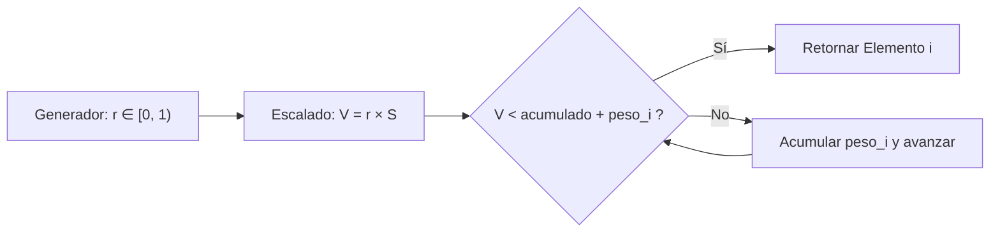
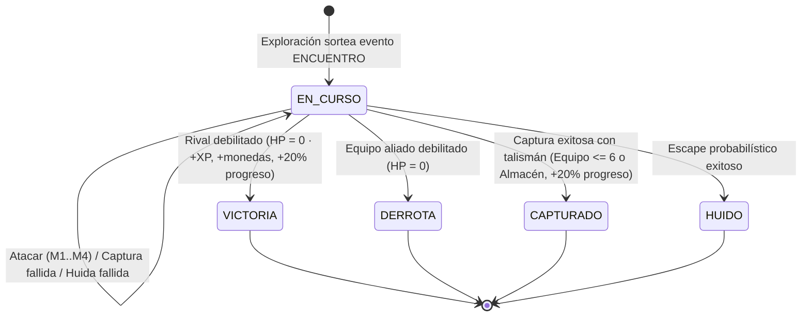
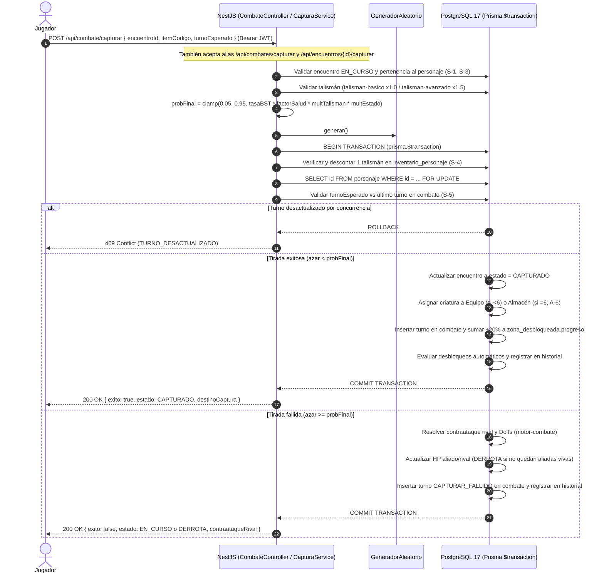

# Informe Técnico - Fases 6 y 7: Reglas de Juego, Exploración, Combate, Captura, Progreso y Economía

Este documento corresponde al capítulo de las **Fases 6 y 7 (Reglas de Juego: Exploración, Encuentros, Combate por Turnos, Captura Probabilística, Progreso, Curación y Comercio)** del Informe Técnico del Proyecto Integrador ISC-305. Documenta la arquitectura del motor determinista del juego, el desacoplamiento del azar mediante abstracciones inyectables, el cumplimiento estricto de los invariantes matemáticos **INV-01**, **INV-02**, **INV-03**, **INV-04** e **INV-05**, la máquina de estados de los encuentros, la transacción atómica de captura y compras en tienda, y el blindaje de seguridad contra peticiones manipuladas (S-3, S-4, S-5, S-6).

---

## 1. Desacoplamiento y arquitectura de aleatoriedad (§3)

### 1.1 El dilema del azar en sistemas evaluables y de alta fidelidad
En el desarrollo de videojuegos y motores de simulación, el uso descontrolado de generadores de números pseudoaleatorios acoplados directamente al entorno de ejecución (como `Math.random()` en JavaScript/Node.js) genera graves patologías de ingeniería de software:
- **Pruebas no reproducibles (Flaky Tests):** Las aserciones automatizadas dependen de valores impredecibles, lo que dificulta la verificación de casos de borde y condiciones de frontera.
- **Dificultad de auditoría:** No es posible recrear una secuencia exacta de decisiones de un jugador o estado de combate reportado por un usuario ante un fallo en producción.
- **Violación del principio de inversión de dependencias:** Los servicios de dominio asumen la responsabilidad colateral de obtener entropía del sistema en lugar de delegarla.

### 1.2 Interfaz pura e inyectable: `GeneradorAleatorio`
Para solucionar este dilema, la arquitectura del proyecto desacopló formalmente la generación de valores en el intervalo continuo $[0, 1)$ a través de un contrato puro:

```typescript
export interface GeneradorAleatorio {
  /**
   * Genera un número pseudoaleatorio en el intervalo uniforme [0, 1).
   */
  generar(): number;
}
```

A partir de este contrato, se implementaron dos concreciones:
1. **`GeneradorAleatorioNativo`:** Empleado en el entorno de producción y ejecución regular del servidor NestJS, encapsula `Math.random()` nativo de V8/Node.js sin sobrecarga de capas adicionales.
2. **`GeneradorAleatorioFijo`:** Empleado en suites de pruebas unitarias e integración, recibe una secuencia determinista inmutable de números de punto flotante precalculados (ej. `[0.0, 0.59, 0.60, 0.85]`). Cada invocación avanza secuencialmente por el arreglo, garantizando que el 100 % de los casos de prueba sigan un camino de ejecución determinista y reproducible al milisegundo.

### 1.3 Utilitario puro de selección ponderada: `SelectorPonderado`
La selección entre múltiples opciones con pesos arbitrarios no se implementa de forma dispersa en controladores o servicios. Se encapsula en la clase utilitaria genérica `SelectorPonderado<T>` (`apps/api/src/comun/azar/selector-ponderado.util.ts`), la cual:
- Recibe una colección genérica de pares `{ elemento: T, peso: number }`.
- Inyecta por parámetro opcional cualquier instancia de `GeneradorAleatorio` (utilizando por defecto `GeneradorAleatorioNativo`).
- Precalcula la suma acumulada total de pesos durante la instanciación.
- Garantiza que la lógica matemática del sorteo sea completamente reutilizable tanto para tablas de eventos de zona como para tablas de fauna/especies salvajes.

---

## 2. Cumplimiento matemático del invariante INV-01

### 2.1 Definición formal del invariante INV-01
El invariante **INV-01** establece que:
$$\sum_{i=1}^k \text{peso}_i > 0 \quad \land \quad \forall i \in \{1, \dots, k\}, \; \text{peso}_i \ge 0$$

Ninguna tabla probabilística de aparición territorial o de eventos de exploración puede estar vacía, contener pesos negativos o sumar cero.

### 2.2 Validación algorítmica en tiempo de construcción
El constructor de `SelectorPonderado<T>` impone salvaguardas estrictas que impiden la instanciación de un selector en un estado matemáticamente inconsistente:

```typescript
if (!items || items.length === 0) {
  throw new Error('La lista de elementos a ponderar no puede estar vacía.');
}

this.sumaPesos = items.reduce((acumulado, actual) => {
  if (actual.peso < 0) {
    throw new Error(`El peso de un elemento no puede ser negativo: ${actual.peso}`);
  }
  return acumulado + actual.peso;
}, 0);

if (this.sumaPesos <= 0) {
  throw new Error('INV-01: La suma total de pesos debe ser estrictamente positiva (> 0).');
}
```

### 2.3 Mecánica de normalización y búsqueda acumulativa
Una vez garantizado que la suma total $S > 0$:
1. Sea $r \in [0, 1)$ el número flotante pseudoaleatorio generado por la abstracción inyectada.
2. Se escala el valor al espacio muestral continuo $[0, S)$:
   $$V = r \times S$$
3. Se itera secuencialmente acumulando los pesos parciales hasta encontrar el primer índice $j$ que verifique:
   $$\sum_{i=1}^j \text{peso}_i > V$$
4. Dicho elemento $j$ es devuelto como la selección formal del sorteo.



Esta búsqueda acumulativa lineal posee una complejidad temporal $O(k)$ con $k \le 5$, lo cual es óptimo en uso de memoria y procesador para las tablas relacionales del juego sin requerir indexación binaria redundante.

---

## 3. Mecánica de exploración en dos etapas (M-EXP, CFG, A-8)

El diseño del motor de exploración desacopla el azar en dos etapas secuenciales parametrizadas 100 % en base de datos (`CFG`), garantizando la regla arquitectónica **A-8** (todas las reglas son evaluadas y validadas en el servidor; el cliente web solo renderiza el resultado devuelto).

### 3.1 Diagrama de flujo de exploración

```mermaid
sequenceDiagram
    autonumber
    actor Jugador
    participant Controller as ExploracionController
    participant Service as ExploracionService
    participant DB as PostgreSQL (Prisma)
    participant Historial as HistorialService

    Jugador->>Controller: POST /api/exploracion/explorar
    Controller->>Service: explorar(usuarioId)
    Service->>DB: Obtener personaje y ubicación actual
    alt Zona es segura (esSegura == true)
        Service-->>Jugador: 403 Forbidden (ZONA_NO_EXPLORABLE)
    else Encuentro previo activo (estado == 'EN_CURSO')
        Service-->>Jugador: 409 Conflict (ENCUENTRO_PREVIO_ACTIVO)
    end

    Note over Service,DB: ETAPA 1: Sorteo de Evento Territorial
    Service->>DB: Consultar evento_zona WHERE zona_id = zona.id
    Service->>Service: SelectorPonderado.seleccionar()

    alt Evento: SIN_EVENTO
        Service->>Historial: registrar('EXPLORACION', 'Recorrido pacífico...')
        Service-->>Jugador: 200 OK { tipoEvento: 'SIN_EVENTO', mensaje, recompensa: null }
    else Evento: OBJETO
        Service->>DB: Transacción: Actualizar monedas o inventario_personaje
        Service->>Historial: registrar('OBJETO', 'Alijo encontrado...')
        Service-->>Jugador: 200 OK { tipoEvento: 'OBJETO', recompensa: {...} }
    else Evento: ENCUENTRO
        Note over Service,DB: ETAPA 2: Sorteo de Criatura y Persistencia
        Service->>DB: Consultar aparicion_zona WHERE zona_id = zona.id
        Service->>Service: SelectorPonderado.seleccionar() (Especie salvaje)
        Service->>Service: Sorteo de nivel uniforme [nivelMinimo, nivelMaximo]
        Service->>Service: Escalado matemático de estadísticas (HP, Atq, Def, Vel)
        Service->>DB: Transacción: Crear Criatura (personajeId=null) y Encuentro (EN_CURSO)
        Service->>Historial: registrar('ENCUENTRO', 'Avistamiento de criatura...')
        Service-->>Jugador: 200 OK { tipoEvento: 'ENCUENTRO', encuentro: {...} }
    end
```



### 3.2 Escalado de estadísticas de criaturas salvajes
Cuando la Etapa 2 selecciona una especie rival, sus estadísticas base son calibradas dinámicamente según el nivel sorteado mediante fórmulas deterministas en el servidor:
- Factor de combate: $F_{\text{combate}} = 1 + (\text{nivel} - 1) \times 0.10$
- Factor de velocidad: $F_{\text{velocidad}} = 1 + (\text{nivel} - 1) \times 0.05$
- Puntos de golpe máximos: $\text{hpMaximo} = \text{round}(\text{hpBase} \times F_{\text{combate}})$
- Puntos de ataque: $\text{ataque} = \text{round}(\text{ataqueBase} \times F_{\text{combate}})$
- Puntos de defensa: $\text{defensa} = \text{round}(\text{defensaBase} \times F_{\text{combate}})$
- Velocidad: $\text{velocidad} = \text{round}(\text{velocidadBase} \times F_{\text{velocidad}})$

---

## 4. Matriz de tablas ponderadas por zona (CFG)

Todas las zonas silvestres (`ZON-01` a `ZON-06`) cuentan con sus tablas sembradas en PostgreSQL con $\sum \text{peso} = 100$ exactos.

### 4.1 Tablas de eventos de exploración (Etapa 1 — `apps/api/prisma/seed.ts`)

| Zona | Nombre de la Zona | ENCUENTRO (%) | OBJETO (%) | SIN_EVENTO (%) | Total Suma |
| :--- | :--- | :---: | :---: | :---: | :---: |
| **ZON-01** | Praderas del Amanecer | 50 % | 30 % | 20 % | 100 (INV-01) |
| **ZON-02** | Riberas del Lago Espejo | 50 % | 30 % | 20 % | 100 (INV-01) |
| **ZON-03** | Bosque Susurrante | 50 % | 30 % | 20 % | 100 (INV-01) |
| **ZON-04** | Paso de los Riscos | 50 % | 30 % | 20 % | 100 (INV-01) |
| **ZON-05** | Cueva Umbría | 50 % | 30 % | 20 % | 100 (INV-01) |
| **ZON-06** | Pico de la Cumbre | 50 % | 30 % | 20 % | 100 (INV-01) |

### 4.2 Tablas de fauna, criaturas especiales y legendarias (Etapa 2 — 30 especies canónicas)

Cada una de las 6 zonas silvestres alberga exactamente **5 especies autóctonas** (`35 % + 35 % + 15 % + 10 % + 5 % = 100 %`, cumpliendo `INV-01`), reservando un **5 %** para su especie ápice regional (**Especial** en `ZON-01`..`ZON-04` y **Legendaria** en `ZON-05`..`ZON-06`):

| Zona | Comunes (35 % c/u) · Frecuente (15 %) · Rara (10 %) | Especial / Legendaria (5 %) | Rango de Nivel |
| :--- | :--- | :--- | :---: |
| **ZON-01** | Lobo Estepario (35 %), Víbora Rocosa (35 %), Ciervo Lunar (15 %), Halcón Ceniza (10 %) | **Oso Fresno** *(Especial)* | 1 – 3 |
| **ZON-02** | Cangrejo Abismal (35 %), Anguila Penumbra (35 %), Quelonio Lacustre (15 %), Tiburón Arrecife (10 %) | **Mantarraya Espectral** *(Especial)* | 2 – 4 |
| **ZON-03** | Araña Gigante (35 %), Jabalí Espinoso (35 %), Basilisco (15 %), Treant Anciano (10 %) | **Mantis Sombría** *(Especial)* | 3 – 5 |
| **ZON-04** | Gárgola (35 %), Esqueleto Guerrero (35 %), Escorpión Obsidiana (15 %), Espectro Ceniza (10 %) | **Golem Granito** *(Especial)* | 5 – 7 |
| **ZON-05** | Elemental Fuego (35 %), Salamandra Magma (35 %), Pesadilla (15 %), Quimera Tricéfala (10 %) | **Behir del Abismo** *(Legendaria)* | 7 – 10 |
| **ZON-06** | Yeti (35 %), Lobo Invernal (35 %), Elemental Agua (15 %), Tigre Dientes Sable (10 %) | **Remorhaz Glaciar** *(Legendaria)* | 8 – 12 |

---

## 5. Persistencia del estado de encuentro y bitácora transversal

### 5.1 Persistencia relacional de encuentros (`M-ENC`)
A diferencia de arquitecturas basadas en memoria volátil o sesiones efímeras, los encuentros en *Aethelgard* persisten de forma transaccional en PostgreSQL (`prisma.$transaction`):
1. La criatura rival generada se inserta en la tabla `criatura` con `personaje_id = NULL`, marcando que pertenece al entorno salvaje.
2. El registro del combate se crea en la tabla `encuentro` con estado `EN_CURSO` asociando la criatura rival, el personaje y la zona.
3. Si el servidor de NestJS o el navegador del cliente se reinicia o se pierde la conexión, la sesión no se corrompe: el endpoint `GET /api/encuentros/activo` consulta directamente la base de datos y recupera el combate con su criatura aliada y rival intactas.

### 5.2 Bitácora transversal e historial paginado (`M-HIS`)
El `HistorialService` actúa como bitácora centralizada accesible para todos los subsistemas del juego. Toda exploración (`EXPLORACION`, `OBJETO`, `ENCUENTRO`) genera registros estructurados con marca de tiempo UTC. La consulta vía `GET /api/historial` implementa paginación estricta (`skip`/`take`) con orden cronológico descendente y metadatos de navegación (`total`, `pagina`, `limite`), garantizando transferencias de datos compactas y escalables.

---

## 6. Máquina de estados del encuentro (§2 y §8)

### 6.1 Estados canónicos y transiciones
El ciclo de vida de un encuentro silvestre responde a una máquina de estados estricta en el servidor (`apps/api/src/modulos/combate/dominio/estado-encuentro.ts`):
$$\text{EN\_CURSO} \longrightarrow \{\text{VICTORIA}, \text{DERROTA}, \text{HUIDO}, \text{CAPTURADO}\}$$

En la base de datos relacional (`encuentro.estado`), el valor inicial persistido es `EN_CURSO` (referenciado por la constante `ESTADOS_ENCUENTRO.ACTIVO = 'EN_CURSO'`). Una vez que el encuentro transiciona a un estado terminal, cualquier petición subsiguiente (`atacar`, `huir`, `capturar`) es rechazada inmediatamente con error `400 Bad Request` (`ENCUENTRO_NO_ACTIVO`).

### 6.2 Diagrama Mermaid de estados del encuentro
El diagrama oficial almacenado en [`docs/diagramas/estados-encuentro.mmd`](../diagramas/estados-encuentro.mmd) ([PNG](../diagramas/estados-encuentro.png)) ilustra las transiciones válidas:



---

## 7. Motor de combate por turnos y cálculo de daño (INV-04, S-5)

### 7.1 Fórmula matemática de daño elemental y táctico (§2.1, Subfase 10k)
El daño de cualquier movimiento ejecutado en combate se calcula unilateralmente en el servidor (`motor-combate.ts`), integrando la matriz de afinidades elementales 6×6 ($F_{\text{afinidad}} \in \{0.75, 1.0, 1.5\}$), la variación estocástica ($\pm 15\,\%$) y los modificadores de los **51 efectos mecánicos únicos** (40 mapeados a 6 estados persistentes + 11 efectos instantáneos):
$$\text{danoBruto} = \left( \frac{\text{ataque}}{\max(1, \text{defensaEfectiva})} \times \text{poder} \times 0.8 \right) + (\text{nivel} \times 0.5)$$
$$\text{danoFinal} = \max\left(1,\; \left\lfloor \text{danoBruto} \times \text{factorVariacion} \times F_{\text{afinidad}} \times \text{multEfecto} \right\rfloor\right) \quad (\text{INV-04})$$

- **Cumplimiento de INV-04:** Incluso contra oponentes con defensa elevada o desventaja elemental ($0.75\times$), la función $\max(1, \dots)$ garantiza que ningún golpe exitoso inflige 0 puntos de daño.
- **Salvaguarda de HP (INV-03):** La salud restante del defensor se acota en $[0, \text{hpMaximo}]$; los daños por estado (`QUEMADURA` 8 %, `VENENO` 6 %) son no letales ($\max(1, \text{hpActual} - \text{dot})$) para favorecer la captura táctica.
- **Resonancia y Movimiento Insignia M4:** Cada ronda acumula Resonancia ($+8$ base, $+10$ por ventaja, hasta $+20$ por daño recibido). Al alcanzar $100\,\%$, se desbloquea el slot 4 (`M4`); cualquier intento previo es rechazado con `400 MOVIMIENTO_BLOQUEADO`.

### 7.2 Resolución de huida y generador determinista (§2.5)
El intento de escape calcula una probabilidad acotada en función de la velocidad efectiva ($\max(1, \lfloor \text{velocidad} \times 0.50 \rfloor)$ bajo `ESCARCHA`) y los intentos previos:
$$\text{probHuidaBruta} = \left(\frac{\text{velEfectivaJugador}}{\text{velEfectivaJugador} + \text{velEfectivaRival}}\right) + 0.10 \times (\text{intentos} - 1)$$
$$\text{probHuidaFinal} = \text{clamp}(0.10, 0.90, \text{probHuidaBruta})$$

La evaluación determinista se realiza inyectando `GeneradorAleatorio` (`generador.generar() < probHuidaFinal`). Si el escape falla, el rival contraataca mediante `resolverRonda` y el turno avanza.

### 7.3 Validación de turno y concurrencia pesimista (S-5)
El servidor valida que el combate esté en `EN_CURSO` y en el turno legítimo del jugador (`esTurnoJugador === true`), serializando toda mutación de combate con `SELECT id FROM personaje WHERE id = ... FOR UPDATE` y verificando `turnoEsperado`. Acciones fuera de turno son rechazadas con `400 ACCION_FUERA_DE_TURNO` y ráfagas concurrentes con `409 Conflict` (`TURNO_DESACTUALIZADO`).

---

## 8. Sistema probabilístico de captura y transacción atómica (INV-02, A-6, S-3, S-4)

### 8.1 Fórmula de probabilidad de captura (§2.2 e INV-02)
La tasa base soberana de la especie ($\text{tasaCaptura} \in [0.10, 0.85]$ derivada del BST) se modula por la salud rival, la calidad del talismán y la sinergia de estados alterados activos:
$$\text{factorSalud} = 1.0 - 0.5 \times \left( \frac{\text{hpActual}}{\text{hpMaximo}} \right)$$
$$\text{probBruta} = \text{tasaCaptura} \times \text{factorSalud} \times \text{multiplicadorTalisman} \times \text{multiplicadorEstado}$$
$$\text{probFinal} = \text{clamp}(0.05, 0.95, \text{probBruta}) \quad (\text{INV-02})$$

- **Multiplicadores:** $1.0$ para `talisman-basico`, $1.5$ para `talisman-avanzado` (alias `talisman-resonante`), y $1.25$ en `multiplicadorEstado` si el rival sufre un estado alterado perjudicial (excluyendo `BASTION`).
- **Invariante INV-02:** Ninguna captura tiene éxito absoluto garantizado ($95\,\%$ máximo) ni es imposible ($5\,\%$ mínimo).

### 8.2 Secuencia de captura y transacción atómica (`prisma.$transaction`)
Toda captura se procesa en una única transacción atómica de base de datos ([`docs/diagramas/secuencia-captura.mmd`](../diagramas/secuencia-captura.mmd) · [PNG](../diagramas/secuencia-captura.png)):



- **Regla A-6 (Límite de escuadrón activo):** Si el personaje tiene $< 6$ criaturas en su equipo, la criatura capturada se incorpora con `enEquipo: true` y `ordenEquipo: cuenta + 1`. Si ya cuenta con 6 criaturas, se envía automáticamente al almacén con `enEquipo: false` y `ordenEquipo: null`.
- **Seguridad S-3 y S-4:** Se verifica que el encuentro pertenezca al personaje autenticado (JWT) y que posea el talismán con cantidad $\ge 1$ en inventario antes de proceder.

---

## 9. Economía, progresión, curación médica y comercio (INV-05, INV-03, S-6)

### 9.1 Progresión de experiencia y subida de nivel (§2.3, §2.4, INV-05)
Al debilitar a un oponente, el servidor otorga experiencia y monedas mediante fórmulas matemáticas unilaterales:
$$\text{xpBase} = \max\left(10, \text{round}(25 \times (1 + \text{challengeRating}))\right)$$
$$\text{xpGanada} = \text{round}\left(\text{xpBase} \times (1 + (\text{nivelRival} - 1) \times 0.20)\right)$$
$$\text{monedas} = \text{round}(15 \times \text{nivelRival})$$

La experiencia acumulada necesaria para alcanzar cada nivel cumple estrictamente el invariante **INV-05**:
$$\text{xpRequerida}(n) = \begin{cases} 0 & \text{si } n = 1 \\ \left\lfloor 50 \times (n - 1)^{1.8} + 100 \times (n - 1) \right\rfloor & \text{si } n > 1 \end{cases}$$

Se comprobó formalmente en pruebas automatizadas que $\text{xpRequerida}(n+1) > \text{xpRequerida}(n)$ para todo $n \in [1, 50]$. Al subir de nivel, las estadísticas base de la criatura escalan proporcionalmente y sus puntos de golpe se restauran al nuevo máximo.

### 9.2 Curación médica y uso de consumibles (`M-CUR`, INV-03)
- `POST /api/curacion/restaurar`: Restringe el servicio a zonas que posean `"CURACION"` o `"CENTRO_CURACION"` y `esSegura === true`. Restaura $HP = \text{hpMaximo}$ para todo el equipo en una transacción.
- `POST /api/inventario/usar`: Valida la posesión de pociones en inventario (S-4) y aplica $\min(\text{hpMaximo}, \text{hpActual} + \text{efectoValor})$ garantizando el invariante **INV-03** sin sobrecuración.

### 9.3 Comercio en tiendas y regla de integridad S-6 (`M-INV`)
- `POST /api/tienda/comprar`: Valida que la zona cuente con servicio `"TIENDA"`, consulta el precio oficial directamente en la tabla `objeto` (impidiendo inyección de costos manipulados por el cliente, regla S-6), valida saldo suficiente ($\text{monedas} \ge \text{costoTotal}$, regla S-4) y ejecuta la compra de manera atómica descontando monedas e incrementando el inventario.

---

## 10. Resumen de invariantes numéricos y cobertura de pruebas

| Invariante | Descripción | Estado de Verificación |
| :--- | :--- | :---: |
| **INV-01** | Suma de pesos estrictamente positiva ($\sum \text{peso}_i > 0$) | Verificado (Fase 6) |
| **INV-02** | Rango de captura acotado a $[0.05, 0.95]$ | Verificado (Fase 7b) |
| **INV-03** | Rango de puntos de golpe $0 \le \text{hpActual} \le \text{hpMaximo}$ | Verificado (Fase 7a, 7c) |
| **INV-04** | Daño mínimo no nulo garantizado ($\text{danoFinal} \ge 1$) | Verificado (Fase 7a) |
| **INV-05** | Progresión monótona creciente de XP ($\text{xpRequerida}(n+1) > \text{xpRequerida}(n)$) | Verificado (Fase 7c) |

