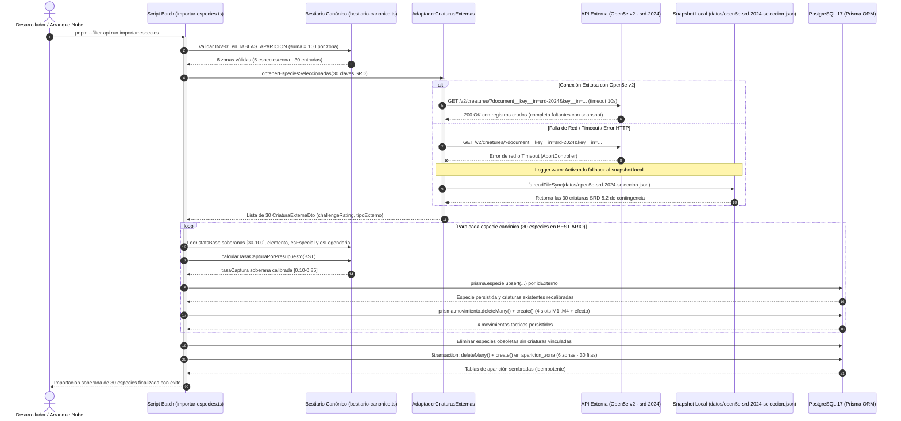

# Informe Técnico - Fase 5: Integración Externa y Normalización de Catálogo (Avance 3, Parte 2)

Este documento corresponde a la primera versión del capítulo de la **Integración Externa** del Informe Técnico del Proyecto Integrador ISC-305. Registra el diseño y construcción del adaptador de criaturas externas contra la API de Open5e (`srd-2024`), la arquitectura de desacoplamiento por lotes, el modelo de contingencia con snapshot estático local versionado, las fórmulas matemáticas de normalización para equilibrar el catálogo y el marco legal de licenciamiento y atribución de contenido.

---

## 1. Desacoplamiento y arquitectura de integración

### 1.1 Principio de aislamiento en tiempo de ejecución (EXT)
Una de las decisiones arquitectónicas fundamentales de *Aethelgard: Sendas y Criaturas* es el **desacoplamiento total entre el tiempo de ejecución del juego y los proveedores externos de datos**:
- **Cero llamadas externas en juego:** Ningún controlador REST (`PersonajesController`, `MundoController`, `EquipoController`, etc.) ni servicio en tiempo real ejecuta peticiones HTTP hacia Open5e. La aplicación web y el servidor operan exclusivamente contra la base de datos relacional PostgreSQL.
- **Ventajas de fiabilidad y rendimiento:**
  - Inmunidad a caídas de red, cuotas de consumo o lentitud en APIs de terceros durante las partidas.
  - Tiempos de respuesta predecibles inferiores a 50 milisegundos en todas las acciones de navegación y consulta.
- **Integración por lotes bajo demanda:** La importación de datos se realiza mediante un script de consola dedicado (`pnpm --filter api run importar:especies`), ejecutado una sola vez durante el despliegue o sincronización del catálogo.

---

## 2. Frontera de datos (Anexo A.2)

La frontera de datos delimita con precisión la procedencia de cada atributo del sistema:

| Atributo en Base de Datos | Origen | Justificación y tratamiento |
| --- | --- | --- |
| `idExterno` (`key`) | Open5e | Identificador alfanumérico único asignado por la fuente (`srd-2024_wolf`, `srd-2024_behir`, etc.). |
| `tipo` | Open5e | Tipo biológico según D&D 5e (`type.key`: `beast`, `monstrosity`, `undead`, `elemental`, `construct`, `plant`). |
| Estadísticas fuente crudas | Open5e | `challenge_rating`, `hit_points`, `armor_class`, `speed_all` empleados como referencia SRD y para `xpBase` (CR). |
| `nombre`, `slug`, `elemento`, `esEspecial`, `esLegendaria` | Propio | Identidad en español (`Lobo Estepario`, `lobo-estepario`), afinidad elemental y jerarquía en `bestiario-canonico.ts`. El nombre en inglés de Open5e **nunca** se expone al jugador. |
| `descripcion` | Propio | Descripción literaria adaptada a la mitología y geografía de Aethelgard. |
| `hpBase`, `ataqueBase`, `defensaBase`, `velocidadBase` | Propio | Estadísticas soberanas acotadas en $[30, 100]$ en bandas disjuntas de BST (`bestiario-canonico.ts`, Subfases 10j/10m). |
| `tasaCaptura` | Propio | Probabilidad soberana en $[0.10, 0.85]$ derivada del presupuesto BST (`calcularTasaCapturaPorPresupuesto`). |
| `movimientos` (4 slots `M1..M4`) | Propio / Mixto | Set de 4 movimientos tácticos por especie con `slot`, `poder` y `efecto` (51 efectos únicos) definidos en `bestiario-canonico.ts`. |
| Nivel, XP, HP actual, pertenencia, orden | Propio | Estado del explorador y dinámica del juego; nunca provienen de la API externa. |
| Tablas de aparición y eventos | Propio | Distribución ecológica por zonas (`30` entradas en `TABLAS_APARICION` y `seed.ts`), cumpliendo `INV-01`. |

---

## 3. Normalización matemática y evolución a soberanía del Bestiario (Anexo A.3 → Subfases 10j y 10m)

Como las magnitudes numéricas del SRD 5e no corresponden a la escala requerida por un sistema de juego web balanceado, en la **Fase 5** se implementó en `normalizador-criaturas.util.ts` una normalización matemática lineal sobre los extremos de referencia del SRD, y posteriormente en las **Subfases 10j y 10m** se consolidó el principio de **soberanía interna** en `bestiario-canonico.ts` sobre el catálogo definitivo de **30 especies** (5 por zona).

### 3.1 Extremos de referencia calibrados en `normalizador-criaturas.util.ts`
- **Puntos de golpe (HP):** $\text{mínimo} = 11$ (`srd-2024_wolf`), $\text{máximo} = 184$ (`srd-2024_hydra`).
- **Promedio de mejor ataque:** $\text{mínimo} = 3.5$ (`srd-2024_cockatrice`), $\text{máximo} = 15.0$ (`srd-2024_allosaurus`).
- **Clase de armadura (AC):** $\text{mínimo} = 8$ (`srd-2024_zombie`), $\text{máximo} = 18$ (`srd-2024_animated-armor`).
- **Velocidad máxima:** $\text{mínimo} = 20$ (`srd-2024_zombie`), $\text{máximo} = 90$ (`srd-2024_air-elemental`).

### 3.2 Fórmulas de escala canónica (escala 30 a 100)
Cada estadística de referencia se mapea según la relación:
$$\text{estadísticaBase} = \operatorname{redondear}\left(30 + 70 \times \frac{\text{valorFuente} - \text{mínimo}}{\text{máximo} - \text{mínimo}}\right)$$

- **Puntos de salud:**
  $$\text{hpBase} = \operatorname{redondear}\left(30 + 70 \times \frac{\text{hit\_points} - 11}{184 - 11}\right)$$
- **Poder de ataque:**
  Calculado sobre el mejor ataque disponible:
  $$\text{ataqueBase} = \operatorname{redondear}\left(30 + 70 \times \frac{\text{mejorAtaque} - 3.5}{15.0 - 3.5}\right)$$
- **Defensa:**
  $$\text{defensaBase} = \operatorname{redondear}\left(30 + 70 \times \frac{\text{armor\_class} - 8}{18 - 8}\right)$$
- **Velocidad:**
  $$\text{velocidadBase} = \operatorname{redondear}\left(30 + 70 \times \frac{\text{speedMax} - 20}{90 - 20}\right)$$

### 3.3 Tasa de captura soberana (Subfase 10m)
En la versión inicial de Fase 5 se empleó una aproximación basada en `challengeRating` (`clamp(0.10, 0.90, 0.90 - 0.07 * CR)`, conservada en `normalizador-criaturas.util.ts` únicamente por compatibilidad con el test del adaptador SRD). En la versión definitiva `v1.0`, todas las especies del juego utilizan la fórmula soberana basada en el presupuesto total de atributos ($\text{BST} = \text{hpBase} + \text{ataqueBase} + \text{defensaBase} + \text{velocidadBase}$), asegurando anticorrelación estricta (`J-5`):
$$\text{tasaCaptura} = \operatorname{clamp}\left(0.10,\; 0.85,\; \operatorname{redondear}\left(\left(1.35 - \frac{\text{BST}}{300}\right) \times 100\right) / 100\right)$$

### 3.4 Cálculo de potencia y sets de 4 movimientos
Para la evaluación histórica de dados SRD en `normalizador-criaturas.util.ts` se conserva `calcularPoderAtaque`:
$$\text{poder} = \text{damage\_die\_count} \times \left(\frac{\text{ladosDelDado}}{2} + 0.5\right) + (\text{damage\_bonus} \mathbin{??} 0)$$
En `v1.0`, el importador `importar-especies.ts` reemplaza la antigua tabla parcial `TRADUCCION_MOVIMIENTOS` por los **4 movimientos tácticos canónicos por especie (`slot 1..4`)** definidos en `bestiario-canonico.ts` (M1 Básico, M2 Táctico, M3 Cobertura y M4 Insignia de Resonancia), cubriendo los **51 efectos mecánicos únicos** del motor de combate.

---

## 4. Mecanismo de tolerancia a fallos y contingencia (Anexo A.4)

Para garantizar la reproducibilidad y robustez de la importación ante contingencias de conectividad:
1. **Timeout con `AbortController`:** La petición HTTP nativa hacia `https://api.open5e.com/v2/creatures/` está protegida por un temporizador de 10 segundos.
2. **Snapshot estático local versionado:** En `datos/open5e-srd-2024-seleccion.json` (con respaldo espejo en `apps/api/src/modulos/externo/snapshot/open5e-srd-2024-seleccion.json`) se almacena el snapshot completo de las **30 especies canónicas** seleccionadas con su estructura cruda del SRD 5.2.
3. **Fallback transparente:** Si la API devuelve menos especies que las solicitadas, retorna error HTTP ($\ge 400$), agota el tiempo de espera o se interrumpe la conexión, `AdaptadorCriaturasExternas` emite una advertencia (`Logger.warn`) y completa o sustituye la carga desde el snapshot local.
4. **Verificación automatizada:** La suite unitaria `adaptador-criaturas-externas.spec.ts` valida la normalización de `srd-2024_wolf`, la tolerancia a `damage_bonus: null` y que, ante una falla simulada de `fetch`, el adaptador activa de inmediato el fallback sobre el snapshot local devolviendo atributos íntegros.

---

## 5. Licenciamiento y atribución legal

Los datos de origen de las criaturas utilizadas provienen del documento oficial `srd-2024` indexado por Open5e, el cual se rige bajo los siguientes términos legales:
- **Licencia Open Game License (OGL v1.0a):** Otorgada por Wizards of the Coast para el uso de mecánicas y estadísticas de referencia abierta.
- **Creative Commons Attribution 4.0 International (CC-BY-4.0):** Reconocimiento de los derechos correspondientes al contenido del System Reference Document 5.2.
- **Atribución de Aethelgard:** En cumplimiento con los términos de dichas licencias y las pautas del plan maestro:
  1. Se acredita expresamente la autoría de Wizards of the Coast y Open5e en este informe técnico.
  2. Los nombres propios de ambientación, descripciones literarias en español, sistema de talismanes, mapa de Aethelgard y balance de estadísticas son creaciones intelectuales originales del equipo de desarrollo de la asignatura.
  3. La interfaz web expone en su vista de créditos (`/creditos`, `PaginaCreditos.tsx`) los avisos completos de atribución de Open5e SRD 5.2 (CC BY 4.0) y la licencia MIT de `8bitcn/ui`.
